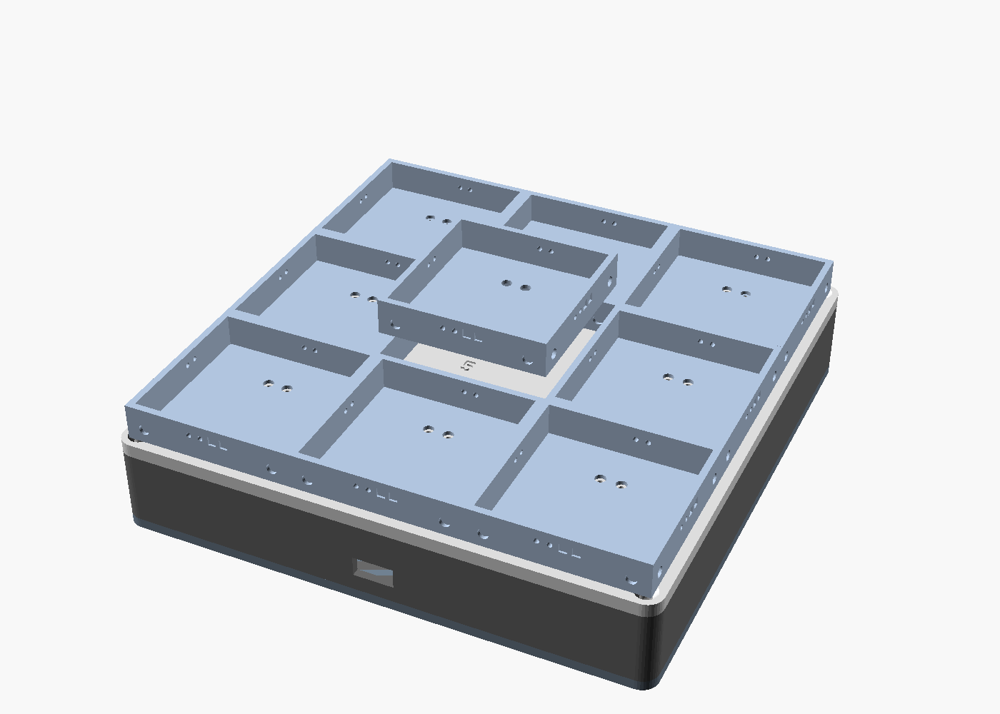
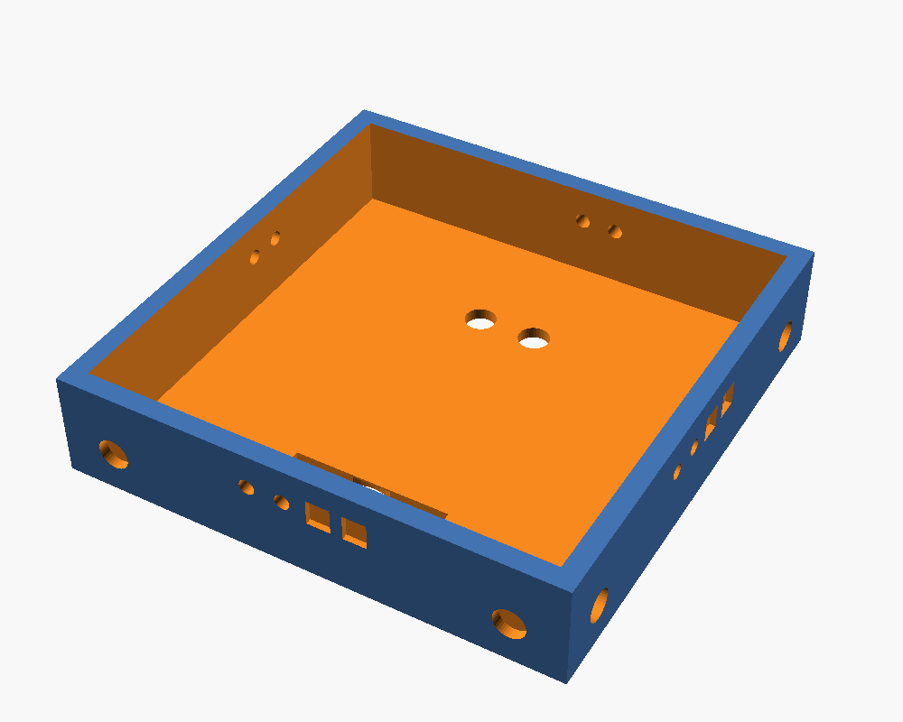
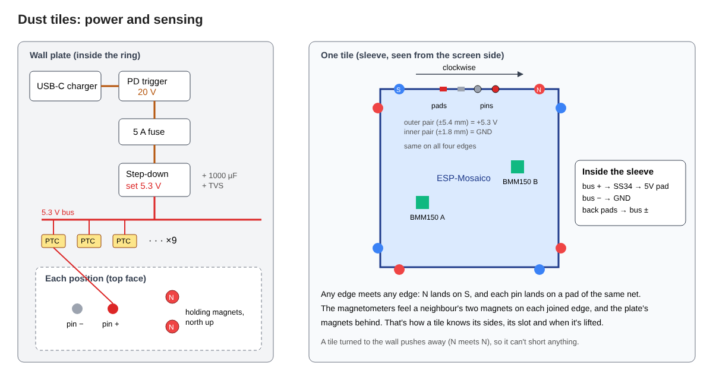

# Dust tiles: build guide

Nine ESP-Mosaico screens that touch edge to edge and hold together with magnets. The same
magnets are the sensor: each screen's two magnetometers feel which edges have a neighbour on
them, so the wall knows its own layout, notices when a tile is pulled away, and works out
which way up each tile is. A wall plate behind them holds them up and feeds power from one
USB-C cable.

- Tile pitch: 50.8 mm (each board in a 2 mm-walled sleeve). Sleeve height 10.8 mm.
- Wall plate: 158.4 × 158.4 × 29 mm.







## How the edges work

Every edge of every sleeve is identical, so any edge mates with any other edge, in any
rotation.

- **Magnets.** Two 3 × 1 mm discs per edge, 20 mm either side of the edge centre, flush with
  the outside face. Looking at the tile from the front, the magnet on the **clockwise** side of
  each edge has **north facing out**, and the one on the other side has south facing out. When
  two edges meet, each north lands on a south, so they pull together. A tile turned over
  (screen to the wall) pushes away instead of joining.
- **Contacts.** Four contacts per edge at −5.4, −1.8, +1.8 and +5.4 mm from the edge centre
  (clockwise positive). The two on the clockwise half are **spring pins**; the two on the other
  half are **flat pads**. The outer pair (±5.4) are **+5.3 V** and the inner pair (±1.8) are
  **GND**. Because the layout is mirror-symmetric and the neighbour's clockwise is our
  anticlockwise, a pin always lands on a pad of the same net.

## Measure before you print

Placeholders are marked `MEASURE` at the top of `dust_tiles.scad`.

| Parameter | What to measure | Placeholder |
|---|---|---|
| `tile` | board outline, square side | 46.0 mm |
| `stack_h` | BaseBoard + CoreBoard height, without the glass | 9.0 mm |
| `back_pad` | where the board's 5V/GND pads are, from its centre | (±3, 11) mm |
| BMM150 A, B | where the two magnetometer chips sit, from the board centre | (−16, 16), (16, −6) mm |

Then check the magnets against the real sensor positions:

```
python3 tools/magnet_check.py --sensor-a X,Y --sensor-b X,Y --sensor-z Z
```

It reports what each sensor reads from its own magnets (must not saturate), what each
neighbour and the wall plate add, and how far apart the closest two combinations of joined
sides are. It needs to say `RESULT: usable`. With the defaults it gives a 24× margin over
sensor noise. If it fails, try a larger `--offset` (moves the magnets toward the corners,
away from the sensors) or `--mag 2x1`.

Also check on the board:

1. **Does the back 5V pad accept power in?** If it's only an output tap, wire the tile's
   power to the input side of the USB-C VBUS instead.
2. **Current per screen** showing Dust with Wi-Fi on. The parts below assume up to 0.8 A.
3. **Does the board have a battery connector?** A tile you lift off the wall stops getting
   power from the plate. With a small LiPo it keeps running and shows its ball; without one it
   goes dark until you put it back (or hold it against another tile, which feeds it through
   the edge contacts).

## Print

PETG (PLA softens near warm boards), 0.2 mm layers, 4 walls, 20 % infill, all flat with no
supports.

```
openscad -D 'part="sleeve"' -o sleeve.stl dust_tiles.scad    # print 9
openscad -D 'part="top"'    -o top.stl    dust_tiles.scad
openscad -D 'part="ring"'   -o ring.stl   dust_tiles.scad
openscad -D 'part="cover"'  -o cover.stl  dust_tiles.scad
```

The STLs here are built from the placeholders; regenerate after measuring. Print one sleeve
first and check the board fit before printing the other eight.

## Parts

| Qty | Part | Notes |
|---|---|---|
| 72 | 3 × 1 mm N42 disc magnets, axially magnetised | 8 per sleeve. Not N52 or bigger: they saturate the magnetometers |
| 18 | 3 × 1 mm N42 disc magnets | Wall plate, 2 per position |
| 18 | 8 × 1 mm steel washers | Sleeve backs, the plate magnets pull on these |
| 72 | Spring pogo pins, 1.5 mm barrel, ~3 mm travel | Sleeves: 2 per edge, 8 per sleeve |
| 18 | Spring pogo pins, same | Wall plate, 2 per position |
| 90 | Contact pads (2.4 × 2.6 mm PCB pads or copper tape) | Sleeves: 2 per edge + 2 on the back, 10 per sleeve |
| 9 | Schottky diode SS34 | One per tile, between its bus and the board |
| 9 | PTC resettable fuse, 1.1 A hold | One per plate position |
| 1 | USB-C charger, 65 W, USB-PD | |
| 1 | USB-C PD trigger board, 20 V | Lines up with the ring opening |
| 1 | 5 V step-down module, ≥ 10 A, adjustable | Set to 5.3 V before connecting anything |
| 1 | Inline blade fuse holder + 5 A fuse | 20 V side |
| 1 | 1000 µF 10 V capacitor + SMBJ5.0A TVS | Across the bus |
| 8 | M3 × 8 mm countersunk self-tapping screws | Top and cover to the ring |
| — | 18 AWG (main), 26 AWG silicone wire (inside sleeves) | |

## Assemble a sleeve

1. **Magnets first, polarity matters.** Mark the north face of a stack of magnets with a
   marker (stick them to a reference magnet: the face that sticks to its south is north). Look
   at the sleeve from the open (screen) side. On each edge, press the clockwise magnet in
   **north out** and the other one **south out**. Glue with a drop of CA. Check every edge by
   offering it to a finished sleeve's edge: it must pull, and the edges must line up.
2. **Edge contacts.** Push a pogo pin into each of the two holes on the clockwise half of every
   edge, tips out, about 1 mm proud. Glue a pad into each of the two recesses on the other
   half. Wire all four outer contacts (±5.4 mm) of all four edges together as the tile's
   **bus +**, and all the inner ones (±1.8 mm) as **bus −**, through the channel inside each
   wall.
3. **Back.** Glue a pad into each of the two back holes (left = −, right = +, looking from the
   back) and connect them to bus − and bus +. Glue the two steel washers into their recesses.
4. **Board.** Bus + goes through an SS34 (stripe toward the board) to the board's 5V pad, bus −
   to GND. The diode stops a tile plugged into a computer from feeding the wall, and drops
   about 0.35 V, which is why the bus runs at 5.3 V. Press the board in.

## Assemble the wall plate

1. **Power in.** PD trigger → 5 A fuse → step-down module. Set the output to **5.3 V** with
   nothing connected. Add the capacitor and TVS across its output.
2. **Positions.** Each of the nine positions has two spring pins through the top (left −,
   right +, looking from the front) and two holding magnets. Feed each position's + from the
   bus through its own 1.1 A PTC, so a short in one tile only cuts that tile.
3. **Holding magnets.** Press them in **north up** in every position. They pull on the
   sleeves' steel washers, so either pole works, but keeping them all the same makes the
   `cal back` signature the same at every position.
4. Screw the top and cover to the ring. Hang it on two pan-head screws 100 mm apart, left 3 mm
   proud of the wall.

## Power budget

Nine screens at up to 0.8 A is 7.2 A at 5.3 V, about 38 W, about 42 W from the charger. Every
tile gets power from the plate under it, and the edge contacts tie all nine buses together,
so they share current with each other and a tile with a dirty back contact still runs. The
edge contacts are rated for about 1 A each; they only need to carry one or two tiles' worth.

## First power-on

1. **Calibrate each tile once.** Each tile learns what its magnetometers read with nothing
   nearby and with a neighbour on each side. Over the serial console (or `cal` in the
   firmware's setup screen):
   - `cal alone`: tile off the plate, nothing magnetic within 20 cm.
   - `cal top`, `cal right`, `cal bottom`, `cal left`: one other sleeve snapped to that edge,
     still off the plate. Top means the edge above the screen's normal "up".
   - `cal back`: on the plate, no neighbours.

   The readings are kept on the tile, so this survives updates. Calibration can use any one
   finished tile as the neighbour.
2. **Put all nine on the plate in any order and any rotation.** Each tile shows which of its
   sides it feels. When all nine form a full 3×3, the tiles work out their own positions (no
   top neighbour = top row, and so on), turn their pictures to match how they're mounted, and
   restart into the wall. You never have to set a slot number.
3. **Lift one off** and Dust reacts the moment its magnets let go.

## Firmware settings

- `CONFIG_DUST_GAP_PX`: the distance between neighbouring screens' lit areas, in pixels. The
  panel is about 12.4 px per mm. Here it's the two sleeve walls plus two screen bezels:
  2 × 2.0 + 2 × 0.4 + about 2 × 3.6 = 12 mm, about **148 px** (the default). Measure your
  bezels and adjust.
